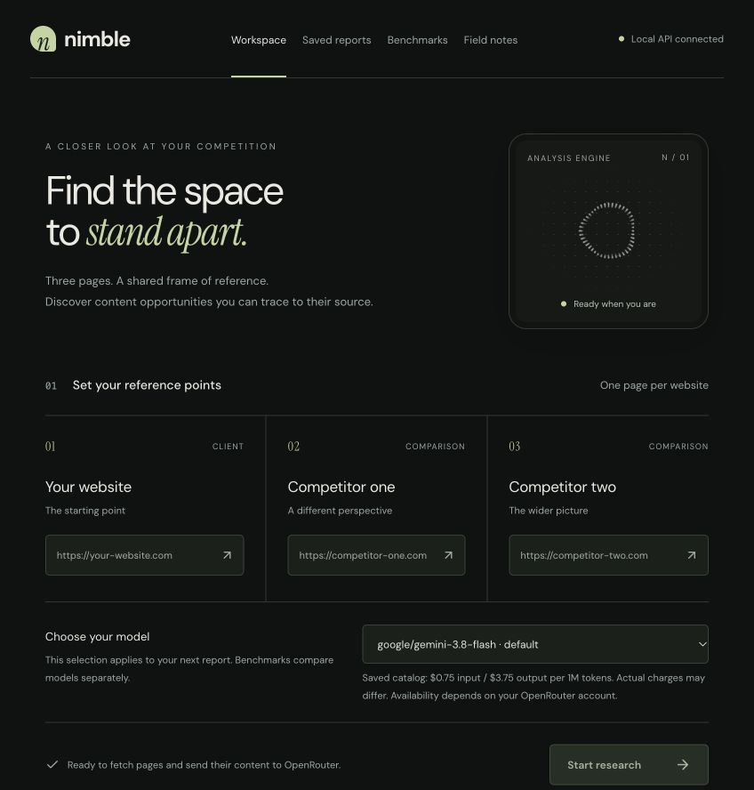

# Nimble Auto-Analyzer

Compare a webpage with two competitors, inspect the evidence behind each finding, and download an SEO research brief.

[](https://github.com/LogicVibe0518/nimble-auto-analyzer/actions/workflows/checks.yml)



Nimble started as a Streamlit prototype for comparing hotel websites. The current app uses a React interface and a FastAPI backend, with separate modules for scraping, model calls, evidence checks and PDF generation. Reports stay in a local SQLite database.

## What you can do

- Compare one page from each of three websites: a client and two competitors.
- Choose an OpenRouter model for each report and see its saved catalog pricing.
- Review keyword opportunities, content suggestions and a proposed meta description alongside source excerpts.
- Reopen saved reports and download their PDFs after restarting the app.
- Run the evaluation CLI against the same frozen inputs across multiple models.

The app runs on your machine. Generating a report sends extracted page content to OpenRouter and the selected model provider.

## Run locally

Use Python 3.12+ and Node.js 22+. From a terminal:

```sh
git clone https://github.com/LogicVibe0518/nimble-auto-analyzer.git
cd nimble-auto-analyzer
python3 -m venv .venv
.venv/bin/python -m pip install -r requirements-local.txt
(cd apps/web && npm ci)
.venv/bin/python scripts/configure_nimble.py
```

The setup script asks for an OpenRouter key and a default model. Use a dedicated key with a spending limit. It saves the configuration in `.env.nimble`, with owner-only permissions; that file is ignored by Git. The script validates the key and retrieves the model catalog without generating a report.

Start the API:

```sh
.venv/bin/python -m uvicorn apps.api.main:app --host 127.0.0.1 --port 8000
```

In another terminal:

```sh
cd nimble-auto-analyzer/apps/web
npm run dev
```

Open [the workspace](http://127.0.0.1:5173), enter three URLs, select a model and start research. [API docs](http://127.0.0.1:8000/docs) and a [health endpoint](http://127.0.0.1:8000/health) are available on port 8000.

Run one backend process on loopback. This is a single-user local app without authentication, so it is not configured for public hosting. The React interface is the supported entry point; `app.py` retains the earlier Streamlit UI.

## How it works

```text
React → FastAPI job queue → acquire pages → generate report → check evidence → PDF
                  ↓                                              ↓
             job status                                  SQLite report archive
```

The API admits up to four jobs with two workers. The scraper checks public destinations, robots policies, redirects, response size and TLS certificates. Pydantic validates the model output; malformed output gets at most one repair attempt. Evidence checks then remove unsupported quotations, ambiguous source attribution and literal keyword gaps already present on the client page.

These checks reduce unsupported findings, but cannot establish that a recommendation is useful or that a business actually offers a suggested service. The report keeps uncertainty notes visible.

See [the architecture decision](docs/adr/0001-local-app.md) for module boundaries and tradeoffs.

## Tests and evaluation

```sh
.venv/bin/python -m pytest -q
.venv/bin/python -m benchmarks.evaluate --mode offline
(cd apps/web && npm run build)
```

The 38 automated tests cover request handling, model selection, credential isolation, scraping restrictions, bounded repair, evidence filtering, persistence and PDF generation. They use mocked external services. GitHub Actions runs the tests, offline fixture audit and frontend build.

The evaluation runner records schema validity, repairs, quote checks, latency, token usage and provider-reported cost. It supports frozen datasets and an explicit API-call ceiling. **No live comparative benchmark results are published.** The included synthetic fixture checks the evaluation code; it does not measure SEO accuracy.

[Evaluation guide →](docs/benchmark-protocol.md)

## Scope

Nimble compares the supplied pages, not entire sites. It does not collect rankings, search volumes or backlinks, and does not render JavaScript-only pages. Missing or blocked sources are reported as unavailable. Review generated claims and suggested copy before using them.

Configuration, report history, captured pages and raw model outputs remain in ignored local files. See [`.env.example`](.env.example) for configuration names and [the evaluation guide](docs/benchmark-protocol.md) for output locations.

## Built with

React · TypeScript · Vite · FastAPI · Pydantic · BeautifulSoup · SQLite · ReportLab · OpenRouter

The animated status indicator uses [Thinking Orbs](https://libraries.dev/orbs) by Libraries.dev (MIT). See the dependency manifests for the other libraries used.
